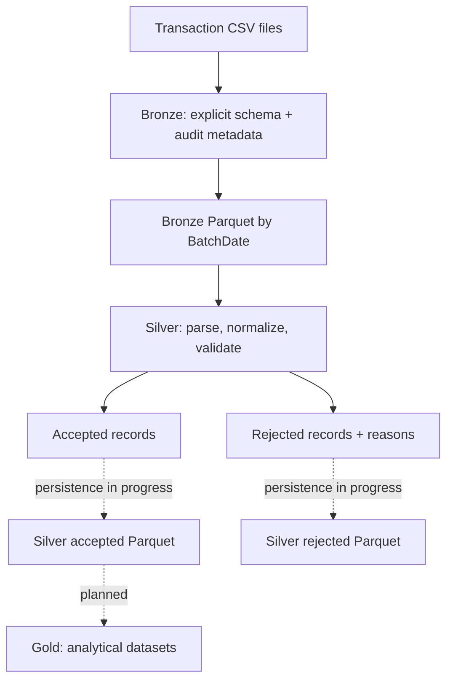

# Financial Transaction Lakehouse ETL Pipeline

An independent data-engineering portfolio project demonstrating ETL design across two complementary implementations: a completed SQL Server pipeline for staged relational processing and an in-progress financial transaction lakehouse pipeline using Python and PySpark. The project is for learning and technical demonstration; it is not a production financial platform and does not represent professional Databricks experience.

## Project overview

The repository began as a SQL Server ETL lab and now extends those data-engineering concepts into a medallion-style financial transaction pipeline.

The SQL Server implementation loads source data through `src`, `stg`, and `rpt` schemas, including validation, change detection, SCD Type 2 dimensions, fact loading, ETL run tracking, and transactional orchestration.

The PySpark implementation follows a medallion-style architecture. Bronze ingestion loads transaction CSV files using an explicit schema, preserves source values as nullable strings, adds audit metadata, and persists batch-partitioned Parquet with rerun-safe overwrite behavior. Silver transformations parse and normalize transaction fields, apply data-quality validation rules, identify duplicate transaction IDs, separate accepted and rejected records, generate structured rejection reasons, and reconcile record counts. Silver Parquet persistence is currently under development. Gold analytical datasets and end-to-end PySpark orchestration remain planned.

## Current status

| Area | Status | Repository evidence |
| --- | --- | --- |
| SQL Server repository foundation | Implemented | `sql/schema/`, `sql/staging/`, `sql/reporting/`, and `sql/etl/` |
| SQL Server staged ETL | Implemented | Staging load procedures, validation messages, reporting loads, and `sql/etl/010_run_pipeline_proc.sql` |
| SQL Server dimensional history | Implemented | Customer and product SCD Type 2 migration/load scripts and historical fact-key resolution |
| Financial explicit PySpark schema | Implemented | `financial-pipeline/src/bronze_transactions.py` defines all six source fields as nullable `StringType` columns |
| Bronze CSV ingestion | Validated under WSL/Linux | Configurable file/directory ingestion with explicit header validation |
| Bronze audit metadata | Validated under WSL/Linux | `SourceFile`, `IngestedAtUtc`, and `BatchDate` |
| Bronze persistence and rerun safety | Validated under WSL/Linux | Batch-specific Parquet output written with overwrite only at `BatchDate=YYYY-MM-DD`; same-batch reruns preserve sibling batch partitions |
| Bronze automated validation | Validated under WSL/Linux | `financial-pipeline/tests/test_bronze_transactions.py` passes all 5 tests covering schema, metadata, persistence, reruns, partition preservation, and failure cases |
| Silver transformations | Implemented | `financial-pipeline/src/silver_transactions.py` parses, normalizes, and validates transaction records |
| Silver data-quality validation | Validated under WSL/Linux | Date, amount, transaction type, transaction ID, and duplicate-ID checks |
| Silver rejection handling | Implemented | Accepted/rejected record separation with structured rejection reasons |
| Silver reconciliation | Implemented | Input count must equal accepted plus rejected counts |
| Silver automated tests | Validated under WSL/Linux | `financial-pipeline/tests/test_silver_transactions.py` includes 9 merged transformation tests |
| Silver Parquet persistence | In progress | Batch-scoped accepted/rejected writes and same-batch rerun tests on `feature/pyspark-silver-persistence` |
| Gold reporting layer | Planned | No financial Gold datasets exist yet |
| Delta Lake persistence | Planned | Bronze v1 uses local Parquet only |
| Databricks execution | Planned | Databricks-compatible direction only; not validated on a Databricks workspace |
| Pipeline orchestration | Planned for PySpark | SQL Server orchestration exists; PySpark orchestration does not |
| CI/CD | Planned | No CI workflow is currently included |

## Architecture



Bronze preserves source values and ingestion metadata. Silver applies business validation, separates accepted and rejected transactions, records rejection reasons, and reconciles row counts. Batch-scoped Silver Parquet persistence is under development, while Gold will provide analysis-ready datasets and financial metrics.

## Data model and Bronze behavior

The transaction source contract is:

| Source column | Bronze type | Notes |
| --- | --- | --- |
| `TransactionId` | string, nullable | Preserved as received |
| `AccountId` | string, nullable | Preserved as received |
| `CreatedDate` | string, nullable | Invalid dates remain observable for later validation |
| `Amount` | string, nullable | Blank, malformed, and signed values are not corrected in Bronze |
| `Currency` | string, nullable | Reference validation is deferred |
| `TransactionType` | string, nullable | Empty or unsupported values are not normalized in Bronze |

All six fields remain nullable strings so ingestion does not silently convert or reject malformed business data. The current sample intentionally contains examples such as whitespace amounts, a malformed date, a duplicate transaction identifier, missing transaction type, an unknown account, and values requiring later business validation.

Bronze adds three audit columns:

- `SourceFile` records the physical source file reported by Spark's `input_file_name()`.
- `IngestedAtUtc` records ingestion time. The Spark session timezone is explicitly set to UTC.
- `BatchDate` is a validated `DateType` value supplied by the execution command.

Spark can apply an explicit CSV schema positionally, so the script validates the source header **before** loading. The header must contain exactly the six expected columns **in the documented order**. This prevents a reordered file from being silently mapped to the wrong fields.

For rerun safety, each execution writes only to:

```text
financial-pipeline/data/bronze/transactions/BatchDate=YYYY-MM-DD/
```

That batch directory is overwritten on a rerun while sibling batch directories remain untouched. Generated Parquet data is excluded from Git.

## Repository layout

```text
sql-data-engineering-lab/
├── financial-pipeline/
│   ├── data/
│   │   └── raw/
│   │       └── transactions/
│   │           └── transactions_2026-09-01.csv
│   ├── src/
│   │   ├── bronze_transactions.py
│   │   └── silver_transactions.py
│   ├── tests/
│   │   ├── test_bronze_transactions.py
│   │   └── test_silver_transactions.py
│   └── requirements.txt
├── sample-data/
│   └── 001_seed_source_data.sql
├── spark/
│   ├── 01_dataframe_basics.py
│   └── 01_dataframe_basics.ipynb
├── sql/
│   ├── schema/
│   ├── staging/
│   ├── reporting/
│   ├── etl/
│   └── transformations/
├── .gitignore
└── README.md
```

`financial-pipeline/` contains the financial transaction pipeline, including Bronze ingestion, Silver transformations, automated tests, and local Parquet persistence work. `spark/` contains earlier PySpark learning exercises. The `sql/` and `sample-data/` directories preserve the original SQL Server ETL implementation.

## Running Bronze locally

The financial PySpark pipeline is developed and tested under Ubuntu on WSL2 using Python 3.14.4, Java 17, and PySpark 4.2.0. Dependencies are defined in `financial-pipeline/requirements.txt`. Java must be available to Spark through the local environment (`JAVA_HOME` where required).

Bronze ingestion, Parquet persistence, and automated tests have been validated under WSL2/Linux. Silver transformations and their automated tests have also been validated. Silver Parquet persistence is currently being developed and tested separately.

From the repository root in an Ubuntu/WSL terminal, activate the Python virtual environment and install dependencies if needed:

```bash
source .venv/bin/activate
python -m pip install -r financial-pipeline/requirements.txt
```

Run Bronze ingestion from the repository root:

```bash
python financial-pipeline/src/bronze_transactions.py \
  --input financial-pipeline/data/raw/transactions/transactions_2026-09-01.csv \
  --bronze-output-root financial-pipeline/data/bronze/transactions \
  --batch-date 2026-09-01
```

Relative arguments are resolved from the repository root determined from the script location, not from the caller's current working directory. Absolute paths are also accepted. This makes the same command arguments usable when the script is launched from another directory.

A successful run logs the resolved input path, batch date, source row count, written row count, and resolved output location. For the included sample file, the expected source and written counts are both 10. Output is Parquet under:

```text
financial-pipeline/data/bronze/transactions/
└── BatchDate=2026-09-01/
    ├── part-....snappy.parquet
    └── _SUCCESS
```

Run the Bronze and Silver automated tests with Python's standard-library test runner:

```bash
python -m unittest discover -s financial-pipeline/tests -p "test_*.py" -v
```

The automated tests use in-memory DataFrames and temporary input/output directories as appropriate. They do not depend on previously generated Bronze or Silver Parquet output in the repository.

## Engineering decisions

- **Explicit schemas instead of inference.** The source contract is visible in code and is not dependent on Spark sampling.
- **Header validation before Spark ingestion.** Because the supplied schema can be applied positionally, exact names and order are checked before loading.
- **Source-faithful Bronze values.** Business fields stay nullable strings so malformed values remain available for later classification rather than being silently corrected.
- **Audit lineage.** Source file, UTC ingestion timestamp, and caller-supplied batch date make each Bronze record traceable to an ingestion event.
- **Working-directory-independent paths.** Relative CLI paths resolve against the repository location derived from `__file__`.
- **Batch-scoped overwrite.** Rerunning one batch replaces only that batch directory, preventing duplicate accumulation while preserving other batches.
- **Persist once during count/write validation.** The Bronze DataFrame is persisted while it is counted and written, then explicitly released.
- **Layer separation.** Bronze ingestion does not trim, cast business fields, deduplicate, perform reference checks, or decide whether a financial record is valid.
- **Explicit Silver validation.** Transaction dates, amounts, types, and identifiers are validated using defined business rules rather than relying solely on successful type conversion.
- **Preservation of invalid source evidence.** Silver retains the raw amount value alongside its parsed decimal representation, allowing malformed values and precision violations to be identified.
- **Structured rejection handling.** Records failing one or more validation rules are separated from accepted records and assigned rejection reason codes for investigation.
- **Reconciliation as a correctness control.** The Silver transformation verifies that the total input record count equals the sum of accepted and rejected records, raising an error when the counts do not reconcile.

## Data quality and validation

### Implemented in Bronze v1

Bronze performs ingestion-contract and operational validation only:

- input path must exist and contain at least one CSV file;
- each CSV header must match the six expected source columns in exact order;
- batch date must be valid `YYYY-MM-DD`;
- source and persisted row counts must match;
- automated tests verify source types, audit columns, requested batch date, Parquet read-back, same-batch rerun safety, and preservation of another batch partition.

### Implemented in Silver

Silver transformations currently implement:

- Transaction date parsing and validation against the batch date.
- Decimal amount parsing, positive-amount validation, and rejection of malformed values or excessive decimal precision.
- Transaction type validation for supported values (`Deposit` and `Withdrawal`).
- Required transaction ID validation and duplicate transaction ID detection within the processed dataset.
- Accepted and rejected record separation.
- Structured rejection reason codes, including support for multiple validation failures on one record.
- Row-count reconciliation to verify that input records equal accepted plus rejected records.

### Planned data-quality enhancements

- Required account ID validation and account/customer reference integrity.
- Supported currency validation and currency normalization.
- Transaction-type/sign consistency rules.
- Cross-batch duplicate detection and historical transaction uniqueness.
- Financial control-total reconciliation, including transaction amount totals.
- Additional validation and recovery controls for persisted Silver batches.

## Roadmap

1. **Bronze v1 — complete:** Explicit schema, header validation, audit metadata, configurable local execution, Parquet persistence, batch rerun safety, and automated tests.
2. **Silver transformations — complete:** Transaction parsing, normalization, date/amount/type/ID validation, duplicate-ID detection, accepted/rejected separation, structured rejection reasons, and row-count reconciliation.
3. **Silver persistence — in progress:** Batch-scoped accepted/rejected Parquet writes and same-batch rerun tests are implemented locally; batch isolation validation and partial-failure recovery remain outstanding.
4. **Advanced financial data quality — planned:** Account and currency reference validation, cross-batch duplicate detection, transaction-type/sign consistency, and financial control-total reconciliation.
5. **Gold analytical datasets — planned:** Daily transaction summaries, account balances, exception reporting, and month-over-month analysis.
6. **Delta Lake — planned:** Evaluate Delta persistence and MERGE-based incremental processing where they improve reliability and maintainability.
7. **Databricks execution — planned:** Introduce configurable execution environments and validate the pipeline on an actual Databricks workspace before claiming Databricks experience.
8. **PySpark orchestration — planned:** End-to-end pipeline execution, structured run logging, failure handling, and recovery.
9. **CI/CD — planned:** Automated test execution and expanded architecture/operational documentation.
10. **Performance evaluation — planned:** Analyze Spark query plans and test performance using appropriately larger datasets.

## Limitations

- The financial data is synthetic practice data, not production financial data.
- Bronze v1 is batch-file ingestion; there is no streaming implementation.
- Bronze persistence is local Parquet, not Delta Lake.
- Silver transformations and row-count reconciliation are implemented, but Silver persistence, end-to-end execution, and Gold analytics are not yet complete.
- Silver duplicate-ID detection currently operates within the processed dataset; historical cross-batch uniqueness is not enforced.
- Silver row-count reconciliation does not provide financial control-total reconciliation or guarantee transaction-level financial correctness.
- Silver accepted and rejected Parquet outputs are written independently; atomic publication and recovery from partial-write failures have not yet been implemented.
- The PySpark pipeline has not been deployed to cloud infrastructure or validated on Databricks.
- There is no production scheduler/orchestrator for the PySpark pipeline.
- CI/CD is not implemented.
- Performance has not been tested at production-scale data volumes.
- Security, access control, encryption, and secrets management are outside the current local milestone.
- Native Windows Parquet persistence is not supported in the tested local configuration: PySpark 4.2.0 with bundled Hadoop 3.5.0 failed during local Parquet writes because the Windows Hadoop filesystem path required `winutils.exe`/`HADOOP_HOME`. No unofficial Hadoop binaries or Windows-specific workaround were added; Bronze v1 persistence was instead validated under WSL2/Linux.

## Portfolio scope

This repository is an independent technical learning project. It demonstrates data-engineering reasoning and implementation practice with SQL Server, Python, and PySpark; it should not be interpreted as a production financial system, client engagement, or claim of professional Databricks/Spark experience.
